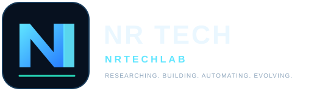
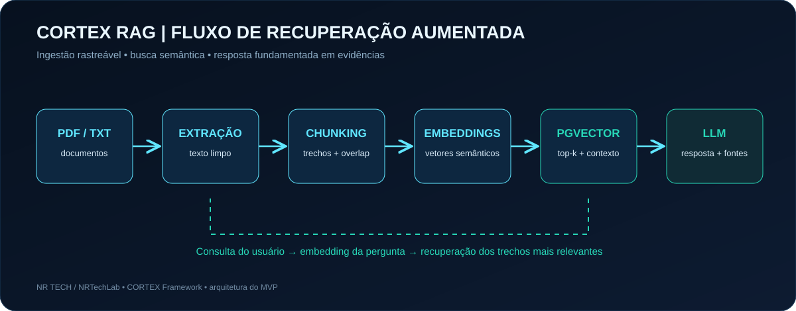

# CORTEX FRAMEWORK
### Intelligent Document Processing · Data Engineering · Applied AI

**Researching. Building. Automating. Evolving.**

---

## Sobre o projeto

O CORTEX Framework organiza uma arquitetura de referência para processamento inteligente de documentos (IDP), engenharia de dados, inteligência artificial e automação de processos corporativos.

O princípio central é transformar conteúdo não estruturado em informação validada, rastreável e consumível por sistemas corporativos — com separação explícita entre inferência probabilística, regras determinísticas e validação de negócio.

> Estado do repositório: framework em evolução. O módulo CORTEX RAG possui uma implementação MVP em uma branch de desenvolvimento; os demais domínios descritos neste documento representam diretrizes arquiteturais, não funcionalidades declaradas como prontas ou em produção.

## Módulos e domínios

| Domínio | Responsabilidade |
|---|---|
| Document Intelligence | Ingestão, extração e classificação documental |
| Data Engineering | Pipelines, qualidade, linhagem e persistência |
| AI / RAG | Busca semântica, recuperação de evidências e geração contextual |
| Automation | Orquestração de tarefas e integração entre sistemas |
| Governance | Auditoria, segurança, validação e observabilidade |

## Módulo em desenvolvimento: CORTEX RAG

O MVP implementa um fluxo documental com FastAPI, PostgreSQL, pgvector e modelos OpenAI. Inclui extração PDF/TXT, chunking, embeddings, recuperação vetorial, respostas com fontes e um conjunto sintético de 20 perguntas para avaliação de recuperação.

- [Acessar o módulo CORTEX RAG](cortex-rag/README.md)
- [Ver a branch de desenvolvimento](https://github.com/nrdataanalysis-1908/CORTEX-Framework/tree/feat/cortex-rag-mvp)

## Princípios de engenharia

- Rastreabilidade entre documento de origem, execução e resultado.
- Idempotência e controle de duplicidade.
- Validação explícita antes de persistir ou distribuir dados.
- Separação entre extração probabilística e regras determinísticas.
- Observabilidade por etapa, com erros classificados e métricas operacionais.
- Segurança por padrão: minimização de dados, acesso restrito e segredos fora do código.
- Avaliação mensurável de qualidade, latência e custo antes de ampliar o escopo.

## Identidade

Deep navy · Neon cyan · Electric blue · Intelligent systems

---

**Desenvolvido por Nadison Roberto | NR TECH / NRTechLab**

*Researching. Building. Automating. Evolving.*

