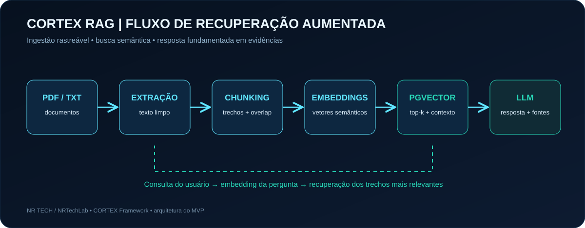
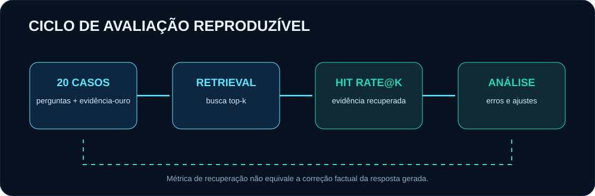

# CORTEX RAG
### Retrieval-Augmented Generation for Document Intelligence

**Technical implementation note · NR TECH Research Laboratory · 2026**

[Research site](https://www.nrtechlab.dev/) · [Framework overview](../README.md) · [Evaluation protocol](evaluation/README.md)

---

## 00 / Abstract

Este módulo implementa um pipeline experimental de Retrieval-Augmented Generation (RAG) para consulta a documentos. O objetivo é investigar a recuperação de evidências documentais e sua utilização como contexto de respostas geradas por um modelo de linguagem.

O escopo atual contempla arquivos PDF digitais e TXT, segmentação textual, embeddings, armazenamento vetorial e recuperação por distância de cosseno. A implementação é um MVP de engenharia; ainda não constitui uma solução validada para produção.

## 01 / System architecture

| Stage | Operação | Componente |
|---|---|---|
| 01 | Document acquisition | FastAPI upload |
| 02 | Text extraction | pypdf / UTF-8 |
| 03 | Chunk segmentation | Python |
| 04 | Vectorization | OpenAI embeddings |
| 05 | Vector persistence and retrieval | PostgreSQL / pgvector |
| 06 | Contextual generation | OpenAI chat completion |

## 02 / Technology profile

| Layer | Technology |
|---|---|
| Language | Python |
| API | FastAPI |
| Database | PostgreSQL 16 |
| Vector extension | pgvector |
| Similarity | Cosine distance |
| ANN index | HNSW |
| Embedding model | text-embedding-3-small |
| Generation model | gpt-4o-mini |
| PDF parser | pypdf |
| Tests | pytest |
| Local environment | Docker Compose |

## 03 / Evaluation protocol

O diretório evaluation contém um documento sintético e 20 perguntas com evidência-ouro. A métrica evidence_hit_rate_at_k calcula a proporção de perguntas em que o trecho de referência foi recuperado entre os primeiros K resultados.

~~~text
evidence_hit_rate_at_k = evidence_hits / total_questions
~~~

O avaliador reporta Recall@K, MRR@K e NDCG@K com relevância binária baseada na correspondência literal da evidência-ouro. Essas métricas medem recuperação e ordenação, não acurácia da resposta, factualidade, groundedness ou ausência de alucinação. Consulte o protocolo metodológico em [evaluation/README.md](evaluation/README.md).

Consulte [evaluation/README.md](evaluation/README.md) para os detalhes e critérios de execução. Para medir latência e throughput sob concorrência controlada, consulte [evaluation/LOAD_TESTING.md](evaluation/LOAD_TESTING.md) e execute `python -m evaluation.load_test`.

## 04 / Local execution

### Requirements

- Python 3.11+
- Docker Desktop
- Chave de API OpenAI

### Environment setup — Windows PowerShell

~~~powershell
cd cortex-rag
python -m venv .venv
.\.venv\Scripts\Activate.ps1
pip install -r requirements.txt
Copy-Item .env.example .env
~~~

Configure as variáveis em .env. Não versione chaves ou segredos.

### Database

~~~powershell
docker compose up -d
~~~

### API

~~~powershell
uvicorn app.main:app --reload
~~~

Swagger UI: http://127.0.0.1:8000/docs

### Tests

~~~powershell
python -m pytest tests -q
~~~

A suíte contém testes unitários e testes de integração que exigem PostgreSQL 16 com pgvector ativo. Os testes de ingestão substituem o provedor de embeddings por funções controladas; não realizam chamadas à API OpenAI. O workflow do GitHub Actions provisiona PostgreSQL automaticamente.

### Retrieval evaluation

1. Faça upload de evaluation/fixtures/manual_operacional_sintetico.txt via POST /documents.
2. Execute:

~~~powershell
python -m evaluation.run_eval --k 5
~~~

3. Analise o relatório em evaluation/results/latest.json.

A execução de avaliação requer PostgreSQL ativo, documento previamente ingerido e credenciais válidas.

## 05 / API surface

| Method | Endpoint | Description |
|---|---|---|
| GET | /health | Liveness check |
| GET | /ready | PostgreSQL readiness check |
| GET | /metrics | Process-local request and latency metrics (JSON) |
| POST | /documents | PDF/TXT ingestion |
| POST | /ask | Contextual question answering |

As respostas HTTP incluem `X-Request-ID` e `X-Process-Time-Ms`. Os logs de requisição são emitidos em JSON. O cliente OpenAI utiliza timeout e número máximo de retries configuráveis; conexões PostgreSQL possuem timeout explícito.

### Security and traffic controls

Os endpoints `/documents`, `/ask` e `/metrics` exigem `X-API-Key`. A chave é validada em tempo constante e nunca é persistida em texto puro. O controle de tráfego utiliza SHA-256 da chave como identificador e uma janela fixa por minuto armazenada no PostgreSQL. O incremento é atômico via `INSERT ... ON CONFLICT`, compartilhado entre workers e réplicas que utilizem o mesmo banco.

O limite padrão é de 60 requisições por minuto por chave e pode ser ajustado por `API_RATE_LIMIT_REQUESTS_PER_MINUTE`. Ao exceder o limite, a API responde HTTP 429 com `Retry-After`. Se o banco não estiver disponível, o controle falha fechado com HTTP 503. `/health` e `/ready` permanecem públicos para probes de infraestrutura. O limite é por chave, não por usuário final ou endereço IP; quotas por tenant, políticas diferenciadas por rota e mitigação de ataques volumétricos na borda permanecem fora deste escopo.

### Observability and reliability baseline

`GET /metrics` apresenta contagem de requisições, erros HTTP 5xx e percentis p50/p95/p99 calculados sobre uma janela em memória de até 10.000 observações. Esses dados são locais ao processo, reiniciam com a aplicação e não devem ser tratados como telemetria distribuída ou SLO de produção. O endpoint exige API Key e rate limit; ainda deve permanecer atrás de TLS e ingress confiável.

O acesso à OpenAI é protegido por uma política de retry limitada e por um circuit breaker compartilhado entre as operações de embeddings e geração dentro do mesmo processo:

- `CLOSED`: permite chamadas e contabiliza falhas transitórias consecutivas.
- `OPEN`: bloqueia chamadas após atingir o limiar de falhas; a API retorna HTTP 503 com `Retry-After`.
- `HALF_OPEN`: após o tempo de recuperação, permite uma única chamada de sondagem. Chamadas concorrentes são rejeitadas até a conclusão da sondagem.
- Uma sondagem bem-sucedida fecha o circuito; uma falha transitória reabre o circuito. Erros permanentes de cliente não são contabilizados como indisponibilidade do provedor.

O acesso ao provedor também utiliza Bulkheads independentes para embeddings e geração. Cada operação possui limite configurável de chamadas simultâneas; ao atingir a capacidade, a API rejeita novas chamadas imediatamente com HTTP 503 e `Retry-After`, sem enfileiramento ilimitado. A vaga é adquirida somente durante cada tentativa de rede e liberada antes do backoff, inclusive em caso de exceção. Rejeições locais por capacidade não contam como falha do provedor nem encerram indevidamente uma sondagem HALF_OPEN. Os contadores de chamadas em voo e rejeições ficam disponíveis em `GET /metrics`, sob `upstream_bulkheads`.

O circuit breaker é thread-safe, mas seu estado é mantido em memória no processo. Portanto, múltiplos workers ou réplicas possuem circuitos independentes; coordenação distribuída não faz parte desta implementação. Os dados do breaker são expostos em `GET /metrics`, sob `upstream_circuit_breaker`, junto das métricas de retry.

Variáveis adicionais:

~~~env
OPENAI_TIMEOUT_SECONDS=30
OPENAI_MAX_RETRIES=2
OPENAI_RETRY_BASE_DELAY_SECONDS=0.5
OPENAI_RETRY_MAX_DELAY_SECONDS=8
CIRCUIT_BREAKER_FAILURE_THRESHOLD=5
CIRCUIT_BREAKER_RECOVERY_TIMEOUT_SECONDS=30
EMBEDDING_MAX_CONCURRENCY=4
CHAT_MAX_CONCURRENCY=4
DATABASE_CONNECT_TIMEOUT_SECONDS=5
API_RATE_LIMIT_REQUESTS_PER_MINUTE=60
~~~

`/health` verifica exclusivamente a liveness da API e permanece disponível mesmo quando a inicialização do banco falha. `/ready` verifica a conectividade PostgreSQL e a existência das tabelas essenciais do RAG. A prontidão não verifica a disponibilidade da OpenAI. A inicialização do esquema é tentada no startup; falhas de banco são registradas sem impedir o processo HTTP de subir.

Exemplo de requisição:

~~~json
{
  "question": "Qual é o prazo-alvo de primeira resposta para P1?"
}
~~~

## 06 / Repository map

~~~text
cortex-rag/
├── app/
│   ├── chunking.py
│   ├── config.py
│   ├── db.py
│   ├── main.py
│   ├── observability.py
│   └── rag.py
├── assets/
│   ├── cortex-rag-architecture.svg
│   └── evaluation-loop.svg
├── evaluation/
│   ├── fixtures/
│   ├── questions.json
│   ├── run_eval.py
│   └── README.md
├── tests/
│   ├── test_chunking.py
│   ├── test_evaluation_dataset.py
│   ├── test_observability.py
│   ├── test_ingestion_idempotency.py
│   └── test_ingestion_atomicity.py
├── .env.example
├── docker-compose.yml
└── requirements.txt
~~~

## 07 / Limitations and controls

- PDFs escaneados não são processados; OCR não está incluído.
- A autenticação usa uma chave de serviço compartilhada; não há identidade individual, RBAC ou isolamento multi-tenant.
- O limite de upload é de 15 MB.
- Chunking utiliza janelas de caracteres, não segmentação semântica.
- O limiar de similaridade é heurístico e requer calibração.
- A avaliação atual não mede factualidade nem qualidade global das respostas. A API reporta `evidence_retrieved` e `groundedness: not_evaluated`; recuperar trechos relevantes não comprova, por si só, que a resposta esteja fundamentada.
- O corpus de teste é sintético; não utilizar documentos pessoais ou confidenciais.
- Segredos devem permanecer em variáveis de ambiente e nunca ser versionados.

## 08 / Engineering roadmap

- [x] Ingestão PDF/TXT e persistência vetorial inicial.
- [x] Chunking isolado e testes unitários.
- [x] Dataset sintético de 20 perguntas.
- [x] Avaliador inicial de recuperação top-K.
- [ ] Baseline integrado reproduzível.
- [x] Testes de contrato para liveness e readiness em falhas de banco.
- [x] Idempotência concorrente por hash com advisory lock transacional no PostgreSQL.
- [x] Teste de integração concorrente contra PostgreSQL/pgvector no CI.
- [x] Testes integrados de rollback e retry após falhas na geração de embeddings e persistência de chunks.
- [x] Harness HTTP de carga concorrente com relatório de throughput, taxa de erro e latência p50/p95/p99.
- [ ] Executar baseline controlado e investigar contenção de locks, throughput e latência p95/p99.
- [ ] Avaliação mensurável de groundedness e factualidade.
- [x] Instrumentação inicial de requisições, latência e logs JSON.
- [x] Retry limitado e circuit breaker thread-safe para indisponibilidade transitória da OpenAI.
- [x] Bulkheads independentes para limitar concorrência de embeddings e geração, com telemetria de saturação.
- [x] API Key compartilhada e rate limiting atômico por chave no PostgreSQL.
- [ ] Métricas Prometheus e tracing distribuído.
- [ ] OCR e avaliação multimodal.

---

**NR TECH Research Laboratory** · CORTEX Framework

Experimental implementation · engineering foundation in progress

